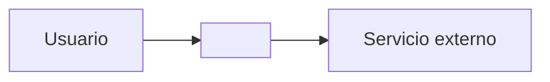
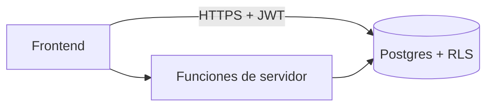

# Arquitectura · <nombre del proyecto>

<!-- masterplan/arquitectura.md · Fase 3. Las secciones son fijas; la línea en cursiva dice qué va.
     Lo que no se puede decidir aún: [ABIERTA: pregunta — bloquea X]. -->

## Resumen
_Tres líneas: qué es, para quién, tipo y perfil elegidos._

## Contexto (C4 nivel 1)
_El sistema como una caja, sus usuarios y los sistemas externos con los que habla._

## Contenedores (C4 nivel 2)
_Las piezas que se despliegan por separado (frontend, base, funciones, terceros) y cómo se comunican._

## Estilo arquitectónico
_Monolito modular por defecto. Módulos y su contrato en una línea cada uno._

| Módulo | Responsabilidad | Expone |
|---|---|---|

## Atributos de calidad
_Los 3 que mandan y el sacrificado, cada uno con requisito medible (ver fundamentos.md)._

| Atributo | Rol | Requisito medible |
|---|---|---|
| | manda | |
| | manda | |
| | manda | |
| | sacrificado | |

## Stack
_Una fila por capa con la razón en una línea. Versiones en proyecto.json, no aquí._

| Capa | Elección | Por qué |
|---|---|---|

## Decisiones (ADR)
_Una por decisión cara de revertir. ADR-001 es la más cara._

### ADR-001 · <título>
- **Contexto:** _qué obliga a decidir._
- **Decisión:** _lo elegido._
- **Descartadas:** _opciones y por qué no._
- **Consecuencias:** _qué se gana, qué se paga, qué se vuelve difícil._
- **Estado:** aceptada · AAAA-MM-DD

## Compatibilidad
_Filas de conocimiento/compatibilidad.md que aplican y cómo se resolvieron._

## Costos
_Costo mensual por servicio a 1× y 10×, y el punto donde salta de plan. "verificar" si no se revisó hoy._

| Servicio | Plan | 1× | 10× | Salta en |
|---|---|---|---|---|

## Riesgos
_Del pre-mortem de la fase 4: riesgo, probabilidad, impacto, mitigación y tarea que lo mitiga._

| Riesgo | Prob. | Impacto | Mitigación | Tarea |
|---|---|---|---|---|

## Non-Goals
_Copia de proyecto.json › alcance.noGoals con cuándo volvería cada uno._
