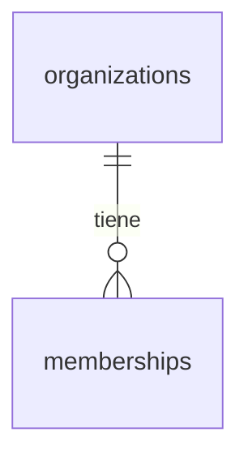

# Datos · <nombre del proyecto>

<!-- masterplan/datos.md · Fase 3 · lo escribe masterplan:arquitecto-datos. -->

## Modelo de tenencia
_Por organización o por usuario, y por qué (enlaza al ADR). Función de autorización común (p. ej. `es_miembro(org_id)`)._

## Diagrama
_Entidades y relaciones en mermaid erDiagram._

## Entidades
_Una subsección por tabla._

### `<tabla>`
| Columna | Tipo | Nulo | Default | Nota |
|---|---|---|---|---|
| `id` | `uuid` | no | `gen_random_uuid()` | |
| `org_id` | `uuid` | no | | dueño |
| `creado` | `timestamptz` | no | `now()` | |

- **Dueño de la fila:** _org, usuario o sistema._
- **Al borrar el padre:** _cascada, restringir o borrado lógico, y por qué._
- **Estados y transiciones:** _si aplica._

## Dinero y fechas
_Unidad mínima en enteros + columna de moneda; `timestamptz` y zona de visualización._

## Índices
_Uno por consulta frecuente, nombrando la consulta que lo justifica._

| Índice | Tabla | Columnas | Consulta que sirve |
|---|---|---|---|

## Operaciones atómicas
_Lo que toca varias tablas y debe ocurrir completo o nada (función de base o transacción)._

## Datos personales y retención
_Qué columnas son datos personales, cuánto se guardan, cómo se borran o anonimizan a pedido._

| Dato | Tabla.columna | Retención | Borrado |
|---|---|---|---|

## Archivos (Storage)
_Buckets, si son privados, estructura de rutas (`<org_id>/...`) y tamaño máximo._

## Semilla
_Qué datos de prueba carga `seed.sql`; nunca datos reales._

## Backups
_Frecuencia, retención y fecha de la próxima restauración de prueba._
